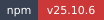
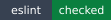
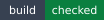
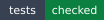

<!-- markdownlint-disable MD013 MD033 -->
<!-- This file is generated by Paradox. Do not edit manually. -->

# @ankhorage/zora

        

Opinionated React Native and React Native Web UI kit built on @ankhorage/surface.

## Usage

### Basic App

ZORA app root with optional runtime capabilities and adaptive UI.

Enable only the runtime capabilities the app uses. `toast` installs the host consumed by
`useToast()`. `bottomSheet` installs the native BottomSheet host; DatePicker and TimePicker use
that host on native and automatically use Popover on web.

```tsx
export default function BasicApp() {
  return (
    <GestureHandlerRootView style={{ flex: 1 }}>
      <ZoraProvider
        bottomSheet
        initialMode="light"
        theme={basicTheme}
        toast={{ defaultDuration: 4000 }}
      >
        <AppShell header={<AppBar title="Dashboard" subtitle="Welcome to ZORA" />}>
          <Screen>
            <ScreenSection>
              <UsageContent />
            </ScreenSection>
          </Screen>
        </AppShell>
      </ZoraProvider>
    </GestureHandlerRootView>
  );
}
```

This package contains 6 additional examples. See the generated documentation for the complete set.

## Documentation

Open `./paradox/index.html` locally in your browser to browse the complete documentation.

## Contributors

<!-- readme: contributors -start -->
<!-- readme: contributors -end -->

## Donation

If this project is useful to you, you can support its continued development.

[Support @ankhorage](https://github.com/sponsors/ankhorage)
